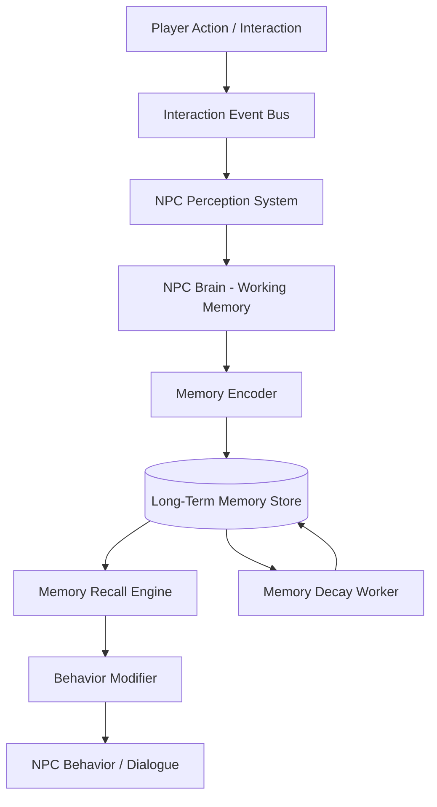

# Stage 1.11 — NPC Brain & Memory System

> **New System** — Added per development direction: *"Create a brain for NPCs to remember player actions (every interaction)."*

## Objective

Give every NPC a **persistent memory** that records every interaction with the player (and eventually with other NPCs), so the world feels truly alive and reactive. An NPC you helped yesterday should greet you warmly today; an NPC you wronged should remember and hold a grudge.

This is the **core differentiator** of Project Earth — NPCs are not state machines that reset, they are agents with histories.

---

## Design Principles

1. **Every interaction is recorded** — No interaction is too small. A wave, a purchase, a collision, a gift — all logged.
2. **Memory is persistent** — Survives save/load, session restarts, and (in shared world) server restarts.
3. **Memory decays realistically** — Trivial memories fade; significant ones persist. Mirrors human memory.
4. **Memory drives behavior** — NPCs change dialogue, prices, willingness to help, and mood based on remembered history.
5. **Scalable** — Must work for 1 NPC or 10,000 NPCs without melting the CPU.
6. **Data-driven** — Memory schema is configurable, not hardcoded.

---

## Architecture Overview



---

## Memory Types

### 1. Episodic Memory (Event-based)
Specific interactions with timestamps.

| Field | Type | Example |
|-------|------|---------|
| `event_id` | String (UUID) | `"evt_8f3a..."` |
| `npc_id` | String | `"npc_shopkeeper_01"` |
| `player_id` | String | `"player_7c2b..."` |
| `event_type` | Enum | `PURCHASED_ITEM`, `GREETED`, `INSULTED`, `HELPED`, `COLLIDED` |
| `timestamp` | int (Unix epoch) | `1721132400` |
| `location` | Vector3 | `(45.2, 0, -120.5)` |
| `details` | Dictionary | `{"item": "bread", "price": 5}` |
| `significance` | float (0.0–1.0) | `0.8` |
| `emotional_weight` | float (-1.0 to 1.0) | `+0.6` (positive) |
| `decay_rate` | float | `0.01` per day |

### 2. Semantic Memory (Factual knowledge)
Generalized facts the NPC has learned.

| Field | Example |
|-------|---------|
| `fact` | `"Player is a regular customer"` |
| `confidence` | `0.9` |
| `source_events` | `[evt_8f3a, evt_9b1c, ...]` |

### 3. Relationship Memory (Aggregated)
A computed summary of the player-NPC relationship.

| Field | Type | Description |
|-------|------|-------------|
| `trust` | float (-100 to 100) | Overall trust level |
| `affinity` | float (-100 to 100) | Like/dislike |
| `familiarity` | int (0–100) | How well they know you |
| `interaction_count` | int | Total interactions |
| `last_interaction` | int | Timestamp |
| `tags` | Array | `["customer", "friend", "rude_person"]` |

---

## Event Types (Extensible Enum)

```gdscript
# scripts/npc/brain/memory_event_types.gd
class_name MemoryEventType

enum {
    GREETED,
    IGNORED,
    PURCHASED_ITEM,
    SOLD_ITEM,
    GAVE_GIFT,
    RECEIVED_GIFT,
    INSULTED,
    COMPLIMENTED,
    HELPED,
    WAS_HELPED,
    HARMED,
    WAS_HARMED,
    COLLIDED,
    BLOCKED_PATH,
    TRESPASSED,
    STOLE_FROM,
    CAUGHT_STEALING,
    SAVED_LIFE,
    BETRAYED,
    KEPT_PROMISE,
    BROKE_PROMISE,
    COMPLETED_FAVOR,
    FAILED_FAVOR,
    WITNESSED_EVENT,
    CONVERSATION,
    CUSTOM
}
```

---

## Significance Scoring

Not every interaction is equally memorable. A significance score (0.0–1.0) determines how strongly a memory persists.

```gdscript
# scripts/npc/brain/significance_scorer.gd
class_name SignificanceScorer

# Base significance by event type
const BASE_SIGNIFICANCE := {
    MemoryEventType.GREETED: 0.1,
    MemoryEventType.PURCHASED_ITEM: 0.3,
    MemoryEventType.GAVE_GIFT: 0.7,
    MemoryEventType.INSULTED: 0.6,
    MemoryEventType.HARMED: 0.95,
    MemoryEventType.SAVED_LIFE: 1.0,
    MemoryEventType.STOLE_FROM: 0.9,
    MemoryEventType.KEPT_PROMISE: 0.5,
    MemoryEventType.BROKE_PROMISE: 0.8,
}

static func calculate(event_type: int, details: Dictionary, npc_state: Dictionary) -> float:
    var base: float = BASE_SIGNIFICANCE.get(event_type, 0.2)
    
    # Gift value increases significance
    if event_type == MemoryEventType.GAVE_GIFT:
        var gift_value: float = details.get("value", 0.0)
        base += clamp(gift_value / 1000.0, 0.0, 0.2)
    
    # First interaction with this NPC is more significant
    if npc_state.get("interaction_count", 0) == 0:
        base += 0.15
    
    # NPC mood modifies — angry NPCs remember slights more
    var mood: float = npc_state.get("mood", 0.0)
    if event_type in [MemoryEventType.INSULTED, MemoryEventType.HARMED] and mood < 0:
        base += 0.1
    
    return clamp(base, 0.0, 1.0)
```

---

## Memory Decay

Trivial memories fade over time so the store doesn't grow infinitely and so NPCs "forget" naturally.

```gdscript
# scripts/npc/brain/memory_decay.gd
class_name MemoryDecay

# Called periodically (e.g., every game-day tick)
static func apply_decay(memory: Dictionary, game_days_passed: float) -> Dictionary:
    var significance: float = memory.get("significance", 0.5)
    var decay_rate: float = memory.get("decay_rate", 0.01)
    
    # Higher significance = slower decay
    var effective_decay := decay_rate * (1.0 - significance)
    var retained: float = memory.get("retention", 1.0) - (effective_decay * game_days_passed)
    
    memory["retention"] = max(retained, 0.0)
    memory["is_forgotten"] = retained <= 0.0
    return memory
```

**Rule:** Memories with `significance >= 0.9` never decay (traumatic or life-saving events are permanent).

---

## Storage Strategy

### Local (Single-player)
- SQLite database per save slot: `saves/<slot>/npc_memory.db`
- Table: `episodic_memories`, `semantic_memories`, `relationships`
- Indexed on `(npc_id, player_id)` for fast recall.

### Shared World (Server)
- Server-side database (PostgreSQL recommended) stores the canonical memory.
- Clients receive relevant memories on-demand (NPC proximity load).
- Writes are batched and sent to server to reduce traffic.

```sql
CREATE TABLE episodic_memories (
    event_id      TEXT PRIMARY KEY,
    npc_id        TEXT NOT NULL,
    player_id     TEXT NOT NULL,
    event_type    INTEGER NOT NULL,
    timestamp     INTEGER NOT NULL,
    location_x   REAL, location_y REAL, location_z REAL,
    details       TEXT,  -- JSON
    significance  REAL NOT NULL,
    emotional_weight REAL NOT NULL,
    decay_rate    REAL NOT NULL,
    retention     REAL DEFAULT 1.0,
    is_forgotten  INTEGER DEFAULT 0,
    INDEX idx_npc_player (npc_id, player_id),
    INDEX idx_timestamp (timestamp)
);
```

---

## Recall Engine

When a player approaches an NPC, the brain queries relevant memories to inform behavior.

```gdscript
# scripts/npc/brain/memory_recall.gd
class_name MemoryRecall

# Returns the most relevant memories for current context
static func recall(npc_id: String, player_id: String, limit: int = 10) -> Array:
    var memories := MemoryStore.query(
        "npc_id = ? AND player_id = ? AND is_forgotten = 0",
        [npc_id, player_id],
        "ORDER BY significance * retention DESC, timestamp DESC LIMIT ?",
        [limit]
    )
    return memories

# Summarize relationship from memories
static func compute_relationship(npc_id: String, player_id: String) -> Dictionary:
    var memories := recall(npc_id, player_id, 100)
    var trust := 0.0
    var affinity := 0.0
    var familiarity := memories.size()
    
    for m in memories:
        var weight := m.significance * m.retention
        trust += m.emotional_weight * weight * 50.0
        affinity += m.emotional_weight * weight * 50.0
    
    return {
        "trust": clamp(trust, -100.0, 100.0),
        "affinity": clamp(affinity, -100.0, 100.0),
        "familiarity": clamp(familiarity, 0, 100),
        "interaction_count": familiarity,
        "last_interaction": memories[0].timestamp if memories else 0,
    }
```

---

## Behavior Modifiers

Memories directly change NPC behavior:

| Relationship State | Behavior Effect |
|--------------------|-----------------|
| Trust > 50 | Discounts on purchases (up to 20%) |
| Trust > 75 | Offers exclusive quests/items |
| Trust < -50 | Refuses service, calls authorities |
| Affinity > 60 | Greets warmly, shares rumors |
| Affinity < -40 | Hostile dialogue, may attack |
| Familiarity > 30 | Uses player's name in dialogue |
| Stole from NPC | Permanently wary, higher prices |
| Saved NPC's life | Permanent ally status |

---

## Performance Considerations

| Concern | Solution |
|---------|----------|
| 10,000 NPCs × 1000s of memories | Only load memories for NPCs near the player (radius-based) |
| Write amplification | Batch memory writes; flush every N seconds, not per event |
| Query cost | Index on `(npc_id, player_id)`; cache relationship summaries |
| Memory bloat | Decay worker prunes forgotten memories nightly |
| Network traffic (shared world) | Send only top-N significant memories per NPC on load |

---

## Integration Points

- **Interaction System** → emits events to `MemoryEventBus`
- **Dialogue System** → queries `MemoryRecall` before generating lines
- **Economy System** → reads `trust` to adjust prices
- **Quest System** → checks relationship thresholds for availability
- **Save System** → serializes/deserializes the memory store
- **Shared World Server** → syncs memory to authoritative DB

---

## Roadmap

| Phase | Feature |
|-------|---------|
| Phase 1 (Stage 2) | Episodic memory, local SQLite, basic recall |
| Phase 2 (Stage 3) | Relationship computation, behavior modifiers |
| Phase 3 (Stage 4) | Semantic memory, dialogue integration |
| Phase 4 (Stage 5) | Server-side persistence, cross-player NPC memory |
