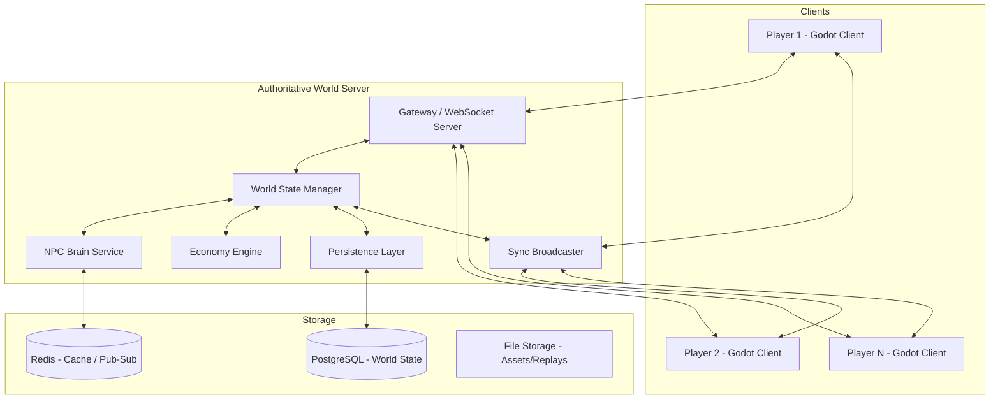

# Stage 1.12 — Shared World Architecture (One World for All Players)

> **New System** — Added per development direction: *"1 world for all player."*

## Objective

Create a **single persistent shared world** where all players inhabit the same Earth. When Player A buys a shop in Nova City, Player B sees it. When Player A helps an NPC, that NPC's memory of the event is visible to all players who interact with that NPC.

This is an **MMO-lite** architecture: one authoritative world state, many players, persistent across sessions.

---

## Design Principles

1. **One world, one truth** — The server is authoritative. Clients never own world state.
2. **Persistent** — The world continues existing even when no players are online.
3. **Real-life activities drive the world** — Economy, NPC schedules, weather, and events progress in real-time.
4. **Solo-friendly fallback** — The game must also work fully offline (single-player) with a local "world server."
5. **Free to host** — Server stack uses only free, open-source tools.
6. **Scalable incrementally** — Start with a single server; shard later if needed.

---

## Architecture Overview



---

## Technology Stack (All Free)

| Component | Tool | Why |
|-----------|------|-----|
| Game Client | Godot Engine | Already chosen |
| Server Runtime | Godot Headless Server | Same engine, same code, authoritative physics |
| Database | PostgreSQL | Robust, free, handles relational world state |
| Cache/PubSub | Redis | Fast NPC memory cache, real-time pub/sub |
| Network Protocol | WebSocket (ENet/WebSocket) | Godot's built-in `MultiplayerAPI` |
| Auth | JWT (JSON Web Tokens) | Stateless, free |
| Hosting | Docker on free-tier cloud or self-hosted | ₹0 budget |

---

## World State Model

The world is divided into **regions** (chunks). Each region is independently simulated and synced.

```text
World
├── Region_001 (Nova City - Downtown)
│   ├── Players: [P1, P3]
│   ├── NPCs: [NPC_001 ... NPC_500]
│   ├── Dynamic Objects: [Shops, Vehicles, Items]
│   └── State: {economy, weather, time}
│
├── Region_002 (Nova City - Harbor)
│   ├── Players: [P2]
│   └── ...
│
└── Region_NNN ...
```

### Interest Management
Players only receive updates for their **current region + neighbors**. This keeps bandwidth manageable.

```gdscript
# scripts/network/interest_manager.gd
class_name InterestManager

const VIEW_RADIUS_REGIONS := 2  # player sees 2 regions around them

static func get_regions_of_interest(player_region: Vector2i) -> Array[Vector2i]:
    var regions: Array[Vector2i] = []
    for x in range(-VIEW_RADIUS_REGIONS, VIEW_RADIUS_REGIONS + 1):
        for y in range(-VIEW_RADIUS_REGIONS, VIEW_RADIUS_REGIONS + 1):
            regions.append(player_region + Vector2i(x, y))
    return regions
```

---

## What Is Shared vs. What Is Local

| Data | Shared (Server) | Local (Client) |
|------|-----------------|----------------|
| Player position | ✅ Synced to nearby players | ✅ Predicted locally |
| NPC positions | ✅ Authoritative | ✅ Interpolated |
| NPC memory | ✅ Canonical in DB | ✅ Cached on demand |
| Economy prices | ✅ Global market | ❌ Read-only |
| Player inventory | ✅ Server-validated | ✅ Cached |
| Player money/bank | ✅ Authoritative | ✅ Displayed |
| World buildings/roads | ✅ Static, server-loaded | ✅ Streamed |
| Weather | ✅ Global simulation | ✅ Rendered locally |
| Player appearance | ✅ Synced to others | ✅ Owned locally |
| Player stats (health) | ✅ Server-validated | ✅ Displayed |

---

## Real-Life Activity Simulation

The world runs on **real-time clock** aligned with real-world time (or a configurable time scale).

### Activity Systems

| System | Real-Life Basis | Implementation |
|--------|-----------------|----------------|
| NPC Schedules | Work hours, sleep, meals | Daily routine scripts per NPC |
| Economy | Supply/demand, inflation | Market simulation tick (every 1 min) |
| Shops | Open/close hours, stock | Shop state machine |
| Traffic | Rush hours, congestion | Traffic density varies by time |
| Weather | Real weather patterns | Weather simulation per region |
| Events | Festivals, accidents, sales | Scheduled + random events |
| Jobs | Real professions | Player + NPC job system |

### Time Scale

```gdscript
# scripts/core/world_time.gd
class_name WorldTime

# 1 real second = 1 game second (real-time mode)
# Configurable: 1 real sec = 60 game sec (accelerated)
var time_scale := 1.0
var game_time: float = 0.0  # Unix epoch in game world

func _process(delta: float) -> void:
    game_time += delta * time_scale
```

---

## Network Protocol

Using Godot's `MultiplayerAPI` with WebSocket transport.

### Message Types

```gdscript
# scripts/network/net_messages.gd
class_name NetMessages

enum {
    # Client -> Server
    C_LOGIN,           # {token, client_version}
    C_PLAYER_INPUT,   # {movement, actions} — 20Hz
    C_INTERACT,       # {target_id, interaction_type}
    C_PURCHASE,       # {shop_id, item_id, quantity}
    C_CHAT,           # {channel, message}
    C_REQUEST_REGION, # {region_id} — subscribe to region updates
    
    # Server -> Client
    S_LOGIN_RESULT,   # {success, player_data}
    S_WORLD_SNAPSHOT,  # {region_state} — on region load
    S_ENTITY_UPDATE,  # {entity_id, state} — delta updates
    S_SPAWN,          # {entity_id, type, position}
    S_DESPAWN,        # {entity_id}
    S_EVENT,          # {event_type, data} — world events
    S_NPC_MEMORY,     # {npc_id, memories} — on proximity
    S_ECONOMY_UPDATE, # {prices} — periodic
}
```

### Tick Rate

| Channel | Rate | Purpose |
|---------|------|---------|
| Player input | 20 Hz | Movement, actions |
| Entity sync | 10 Hz | Position/rotation deltas |
| Region snapshot | On-demand | Full state on region load |
| Economy | 1/min | Price updates |
| Events | Event-driven | Asynchronous |

---

## Persistence

### PostgreSQL Schema (Core)

```sql
-- Players
CREATE TABLE players (
    player_id     TEXT PRIMARY KEY,
    username      TEXT UNIQUE NOT NULL,
    created_at    TIMESTAMP DEFAULT NOW(),
    last_login    TIMESTAMP,
    position_x    REAL, position_y REAL, position_z REAL,
    money         REAL DEFAULT 0,
    bank_balance  REAL DEFAULT 0,
    health        REAL DEFAULT 100,
    stats         TEXT,  -- JSON
    appearance    TEXT   -- JSON
);

-- World objects (shops, vehicles, dynamic items)
CREATE TABLE world_objects (
    object_id     TEXT PRIMARY KEY,
    region_id     TEXT NOT NULL,
    object_type   TEXT NOT NULL,
    owner_id      TEXT,  -- player_id or NULL
    position_x   REAL, position_y REAL, position_z REAL,
    state         TEXT,  -- JSON
    updated_at    TIMESTAMP DEFAULT NOW()
);

-- NPC memory (links to Stage 1.11)
CREATE TABLE npc_memories (
    event_id      TEXT PRIMARY KEY,
    npc_id        TEXT NOT NULL,
    player_id     TEXT NOT NULL,
    event_type    INTEGER NOT NULL,
    timestamp     INTEGER NOT NULL,
    details       TEXT,
    significance  REAL NOT NULL,
    retention     REAL DEFAULT 1.0,
    INDEX idx_npc_player (npc_id, player_id)
);

-- Economy
CREATE TABLE market_prices (
    item_id       TEXT PRIMARY KEY,
    base_price    REAL NOT NULL,
    current_price REAL NOT NULL,
    supply        REAL DEFAULT 100,
    demand        REAL DEFAULT 100,
    updated_at    TIMESTAMP DEFAULT NOW()
);
```

---

## Offline / Single-Player Mode

The same server code runs **embedded** in the client for offline play.

```gdscript
# scripts/core/world_server_bridge.gd
class_name WorldServerBridge

enum Mode { OFFLINE_SINGLEPLAYER, ONLINE_SHARED }

var mode: Mode = Mode.OFFLINE_SINGLEPLAYER

func start_offline() -> void:
    mode = Mode.OFFLINE_SINGLEPLAYER
    # Run server logic in-process using a local SQLite DB
    LocalWorldServer.start()

func connect_online(server_url: String, token: String) -> void:
    mode = Mode.ONLINE_SHARED
    # Connect to remote server via WebSocket
    NetworkClient.connect_to_server(server_url, token)
```

This means **one codebase** for both modes — the only difference is where the authoritative state lives.

---

## Security Considerations

| Threat | Mitigation |
|--------|------------|
| Cheating (position teleport) | Server validates all movement |
| Duplication glitches | Server owns inventory/money; client requests |
| Memory tampering | NPC memory is server-authoritative |
| DDoS | Rate limiting per IP; WebSocket connection limits |
| Account theft | JWT with short expiry + refresh tokens |
| Data corruption | Daily PostgreSQL backups + WAL archiving |

---

## Scalability Path

| Stage | Setup | Capacity |
|-------|-------|----------|
| Prototype | Single Godot headless server | 10–50 players |
| Early Access | Single server + Redis cache | 100–500 players |
| Launch | Region-sharded servers | 1,000–5,000 players |
| Scale | Kubernetes + load balancer | 10,000+ players |

---

## Integration with NPC Brain (Stage 1.11)

The NPC Brain system (Stage 1.11) is fully integrated:
- NPC memories are stored in the shared `npc_memories` table.
- When Player B interacts with an NPC that Player A previously helped, the NPC recalls Player A's actions and may mention them.
- This creates a **living, interconnected social fabric** across all players.

---

## Roadmap

| Phase | Feature |
|-------|---------|
| Phase 1 (Stage 2) | Offline single-player with local server |
| Phase 2 (Stage 3) | Local world state persistence (SQLite) |
| Phase 3 (Stage 4) | WebSocket server, basic multiplayer (2 players) |
| Phase 4 (Stage 5) | Full shared world, region sharding, economy sync |
