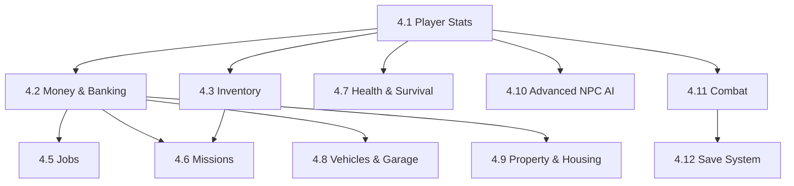

# Stage 4 — Gameplay Phase

Nova City exists. It has roads, buildings, NPCs, traffic, and a day-night cycle. But a city without gameplay is just a diorama. Stage 4 transforms the playable city into a *game* by adding money, inventory, jobs, missions, vehicles, property, advanced AI, combat, and a save system.

---

## Goal
Layer all core gameplay systems onto the Nova City foundation, creating a complete game loop with progression, goals, and player agency.

---

## Stage 4 Sub-Steps Overview

| Stage | Title | Focus |
| :--- | :--- | :--- |
| **4.1** | Player Character & Stats | Health, stamina, hunger, skills, leveling |
| **4.2** | Money & Banking | Currency, bank accounts, ATMs, transactions |
| **4.3** | Inventory System | Items, weight, slots, drag-and-drop UI |
| **4.4** | Phone & Communication | In-game phone, contacts, messages, map app |
| **4.5** | Jobs & Careers | Job types, work mini-games, promotions |
| **4.6** | Missions & Story | Mission system, story arcs, objectives |
| **4.7** | Health & Survival | Hunger, thirst, sleep, injury, hospitals |
| **4.8** | Vehicles & Garage | Vehicle ownership, garage, customization |
| **4.9** | Property & Housing | Buy/rent homes, furniture, storage |
| **4.10** | Advanced NPC AI | Schedules, relationships, dialogue |
| **4.11** | Combat System | Melee, weapons, police response |
| **4.12** | Save System & Polish | Save/load, settings, final polish |

---

## Architecture Overview

```text
GameplayManager (Autoload)
├── PlayerStats
├── EconomyManager (from Stage 3.5)
├── InventorySystem
├── PhoneSystem
├── JobManager
├── MissionManager
├── HealthSystem
├── VehicleManager
├── PropertyManager
├── NPCRelationshipSystem
├── CombatManager
└── SaveManager
```

---

## Dependencies



---

## Completion Criteria

Stage 4 is complete when the player can:

1. ✅ Earn and spend money through jobs and missions
2. ✅ Carry and manage an inventory of items
3. ✅ Use an in-game phone for communication and navigation
4. ✅ Work jobs to earn income
5. ✅ Complete missions with objectives and rewards
6. ✅ Manage health, hunger, and stamina
7. ✅ Own, customize, and store vehicles
8. ✅ Buy or rent property and furnish it
9. ✅ Interact with NPCs that have schedules and relationships
10. ✅ Engage in combat with consequences
11. ✅ Save and load their progress
12. ✅ Experience a full gameplay loop from start to a satisfying session end

---

## Transition to Stage 5

Once Stage 4 delivers a complete gameplay loop within Nova City, Stage 5 expands the world with new cities, rural areas, airports, wildlife, weather, and eventually multiplayer and mod support.
