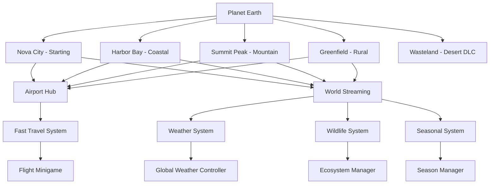

# Stage 5 — Expansion Phase

The Expansion Phase grows Project Earth beyond Nova City into a full planet with new cities, biomes, wildlife, weather, and multiplayer.

---

## Goal
Expand the game world from a single city to a living planet with diverse biomes, new cities, wildlife, weather systems, multiplayer, mod support, and a final release.

---

## Sub-Stages Overview

| Stage | Title | Description |
| :--- | :--- | :--- |
| **5.1** | World Expansion Architecture | Technical foundation for streaming multiple regions |
| **5.2** | New Cities | Design and build 3 additional cities with unique character |
| **5.3** | Airports & Fast Travel | Airports, flights, and fast travel between cities |
| **5.4** | Countryside & Farms | Rural areas, agriculture, farming activities |
| **5.5** | Mountains & Wilderness | Mountain biomes, hiking, camping, survival |
| **5.6** | Beaches & Coastlines | Coastal areas, swimming, boats, water activities |
| **5.7** | Wildlife & Ecosystems | Animals, ecosystems, hunting, fishing |
| **5.8** | Weather & Seasons | Dynamic weather, seasonal changes, environment effects |
| **5.9** | Multiplayer & Co-op | Online co-op, shared worlds, social features |
| **5.10** | Mod Support & Workshop | Modding tools, Steam Workshop, community content |
| **5.11** | Endgame & Post-Launch | Endgame content, DLC planning, live events |
| **5.12** | Final Release & Beyond | Launch, marketing, community, future roadmap |

---

## Expansion Architecture Overview

---

## Completion Criteria

1. ✅ At least 3 new cities fully playable
2. ✅ Airport fast travel system functional
3. ✅ Countryside, mountains, and beaches explorable
4. ✅ Wildlife system with 20+ animal species
5. ✅ Dynamic weather with 4 seasons
6. ✅ Multiplayer co-op for 2-4 players
7. ✅ Mod tools and Workshop integration
8. ✅ Endgame content with replayability
9. ✅ All systems performant at expanded scale
10. ✅ Community feedback incorporated
11. ✅ Marketing materials ready
12. ✅ Final release build stable

---

## Transition from Stage 4

Stage 4 delivered a complete single-city experience with all core gameplay systems. Stage 5 takes that foundation and scales it to a planet-wide sandbox, adding new biomes, activities, and social features that transform Project Earth from a city sim into a world sim.

---

## Technical Considerations

- **World Streaming**: Regions load/unload dynamically based on player position
- **Data Management**: Each city/region is a self-contained scene bundle
- **Multiplayer**: Server-authoritative architecture with client-side prediction
- **Modding**: Data-driven design allows community content creation
- **Performance**: Expanded world requires aggressive LOD and streaming

The following sub-stages detail each expansion component.
