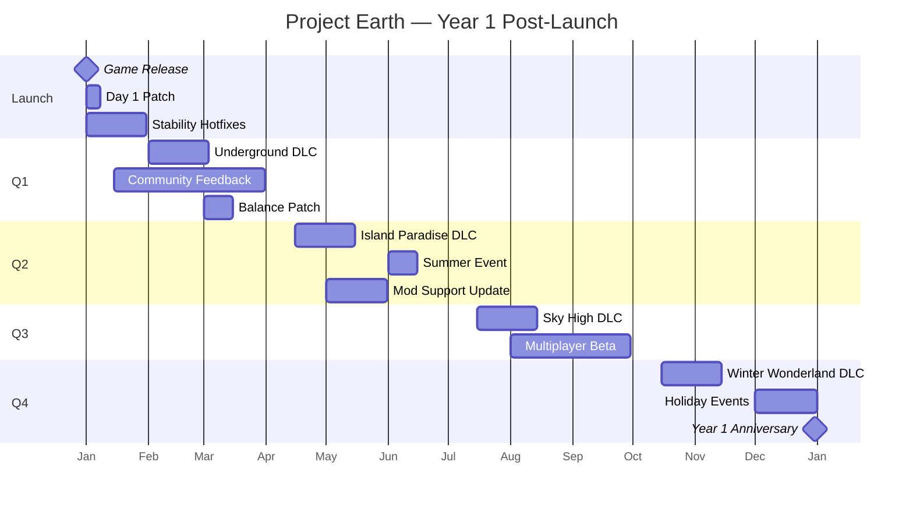

# Stage 5.11 — Endgame & Post-Launch

The endgame phase ensures players have long-term goals after completing the main story, while post-launch support keeps the game alive with regular updates, live events, DLC expansions, and community engagement.

---

## Goal
Design a compelling endgame loop with prestige systems, repeatable challenges, live events, seasonal content, DLC roadmap, and a sustainable post-launch update cadence that keeps the community engaged for years.

---

## Step 1 — Endgame Architecture Overview

```text
┌─────────────────────────────────────────────────────────────────┐
│                    Endgame System Architecture                   │
│                                                                  │
│   ┌─────────────┐    ┌─────────────┐    ┌─────────────┐        │
│   │  Prestige    │    │  Endgame    │    │  Live       │        │
│   │  System      │───►│  Content    │───►│  Events     │        │
│   │  (rebirth,   │    │  (repeatable│    │  (seasonal, │        │
│   │   bonuses)   │    │   challenges)│    │   limited)  │        │
│   └─────────────┘    └─────────────┘    └─────────────┘        │
│                                                                  │
│   ┌─────────────┐    ┌─────────────┐    ┌─────────────┐        │
│   │  DLC         │    │  Update     │    │  Community  │        │
│   │  Roadmap     │    │  Pipeline   │    │  Engagement │        │
│   │  (expansions)│    │  (patches)  │    │  (feedback) │        │
│   └─────────────┘    └─────────────┘    └─────────────┘        │
│                                                                  │
└─────────────────────────────────────────────────────────────────┘
```

### Endgame Progression Tiers

| Tier | Requirement | Unlocks | Description |
| :--- | :--- | :--- | :--- |
| **Tier 1: Veteran** | Complete main story | Harder missions, elite shops | Post-story content begins |
| **Tier 2: Master** | All cities explored | Master challenges, rare items | Mastery of game world |
| **Tier 3: Legend** | 100% completion | Legendary items, titles | Full game mastery |
| **Tier 4: Prestige** | All achievements | Prestige reset with bonuses | New game+ equivalent |
| **Tier 5: Mythic** | 5 prestige cycles | Mythic challenges, cosmetics | Ultimate endgame |

---

## Step 2 — Prestige System

### `PrestigeSystem.gd`

```gdscript
extends Node
class_name PrestigeSystem

const MAX_PRESTIGE_LEVEL = 10

var current_prestige: int = 0
var prestige_bonuses: Dictionary = {}

signal prestige_unlocked(level: int)
signal prestige_reset()

func _ready() -> void:
    _load_prestige_data()

func can_prestige() -> bool:
    # Requirements: completed main story, all achievements, minimum wealth
    var stats = PlayerStats.get_stats()
    return (
        stats.story_completed and
        stats.achievements_count >= AchievementSystem.get_total_count() * 0.8 and
        stats.total_earned >= 10_000_000 and
        current_prestige < MAX_PRESTIGE_LEVEL
    )

func prestige() -> void:
    if not can_prestige():
        return
    
    current_prestige += 1
    
    # Calculate bonuses
    var bonuses = _calculate_prestige_bonuses(current_prestige)
    prestige_bonuses = bonuses
    
    # Reset player progress but keep prestige bonuses
    prestige_reset.emit()
    _reset_player_progress()
    _apply_prestige_bonuses(bonuses)
    
    # Unlock prestige-specific content
    _unlock_prestige_content(current_prestige)
    
    prestige_unlocked.emit(current_prestige)
    _save_prestige_data()
    
    UI.show_notification("Prestige %d unlocked! New bonuses active." % current_prestige)

func _calculate_prestige_bonuses(level: int) -> Dictionary:
    return {
        "money_multiplier": 1.0 + (level * 0.10),      # +10% per prestige
        "xp_multiplier": 1.0 + (level * 0.15),          # +15% per prestige
        "starting_money": 50000 * level,                 # More starting cash
        "max_inventory": 50 + (level * 10),             # Bigger inventory
        "vehicle_discount": level * 0.05,                # 5% off per prestige
        "extra_save_slots": level,                        # More save slots
        "fast_travel_discount": level * 0.10,             # Cheaper fast travel
        "skill_point_bonus": level * 2,                  # Extra skill points
    }

func _reset_player_progress() -> void:
    # Reset story progress
    StorySystem.reset_progress()
    
    # Reset player stats (keep prestige level)
    PlayerStats.reset_to_default()
    
    # Reset money (but give starting bonus)
    PlayerStats.money = prestige_bonuses["starting_money"]
    
    # Reset inventory
    InventorySystem.clear_inventory()
    
    # Reset missions
    MissionSystem.reset_all_missions()
    
    # Reset relationships
    RelationshipSystem.reset_all_relationships()
    
    # Keep: prestige level, cosmetics, achievements, playtime

func _apply_prestige_bonuses(bonuses: Dictionary) -> void:
    PlayerStats.money_multiplier = bonuses["money_multiplier"]
    PlayerStats.xp_multiplier = bonuses["xp_multiplier"]
    PlayerStats.max_inventory_size = bonuses["max_inventory"]
    PlayerStats.vehicle_discount = bonuses["vehicle_discount"]
    PlayerStats.fast_travel_discount = bonuses["fast_travel_discount"]
    PlayerStats.add_skill_points(bonuses["skill_point_bonus"])

func _unlock_prestige_content(level: int) -> void:
    match level:
        1:
            # Unlock prestige shop
            ShopSystem.unlock_shop("prestige_shop")
        3:
            # Unlock exclusive vehicles
            VehicleDatabase.unlock("prestige_luxury_yacht")
            VehicleDatabase.unlock("prestige_private_jet")
        5:
            # Unlock mythic challenges
            ChallengeSystem.unlock_category("mythic")
        7:
            # Unlock exclusive property
            PropertySystem.unlock("prestige_mansion")
        10:
            # Unlock everything + special ending
            StorySystem.unlock_secret_ending()

func _save_prestige_data() -> void:
    var data = {
        "current_prestige": current_prestige,
        "prestige_bonuses": prestige_bonuses,
    }
    SaveSystem.save_global_data("prestige", data)

func _load_prestige_data() -> void:
    var data = SaveSystem.load_global_data("prestige")
    if not data.is_empty():
        current_prestige = data.get("current_prestige", 0)
        prestige_bonuses = data.get("prestige_bonuses", {})
        if not prestige_bonuses.is_empty():
            _apply_prestige_bonuses(prestige_bonuses)

func get_prestige_info() -> Dictionary:
    return {
        "current_level": current_prestige,
        "max_level": MAX_PRESTIGE_LEVEL,
        "bonuses": prestige_bonuses,
        "can_prestige": can_prestige(),
        "progress": _calculate_prestige_progress(),
    }

func _calculate_prestige_progress() -> float:
    var stats = PlayerStats.get_stats()
    var story_progress = 1.0 if stats.story_completed else 0.5
    var achievement_progress = float(stats.achievements_count) / AchievementSystem.get_total_count()
    var wealth_progress = min(stats.total_earned / 10_000_000.0, 1.0)
    return (story_progress + achievement_progress + wealth_progress) / 3.0
```

### Prestige Bonuses Table

| Prestige Level | Money Mult | XP Mult | Starting Cash | Max Inventory | Vehicle Discount |
| :---: | :---: | :---: | :---: | :---: | :---: |
| 1 | 1.10x | 1.15x | ₹50,000 | 60 | 5% |
| 2 | 1.20x | 1.30x | ₹100,000 | 70 | 10% |
| 3 | 1.30x | 1.45x | ₹150,000 | 80 | 15% |
| 5 | 1.50x | 1.75x | ₹250,000 | 100 | 25% |
| 7 | 1.70x | 2.05x | ₹350,000 | 120 | 35% |
| 10 | 2.00x | 2.50x | ₹500,000 | 150 | 50% |

---

## Step 3 — Endgame Challenges

### `EndgameChallengeSystem.gd`

```gdscript
extends Node
class_name EndgameChallengeSystem

var active_challenges: Dictionary = {}
var challenge_history: Array = []

const CHALLENGE_CATEGORIES = {
    "combat": "Combat Mastery",
    "economic": "Economic Empire",
    "exploration": "World Explorer",
    "social": "Social Butterfly",
    "survival": "Survival Expert",
    "speedrun": "Speed Demon",
    "mythic": "Mythic Trials",
}

signal challenge_started(challenge_id: String)
signal challenge_completed(challenge_id: String, score: float)
signal challenge_failed(challenge_id: String)

func _ready() -> void:
    _generate_daily_challenges()
    _generate_weekly_challenges()

func _generate_daily_challenges() -> void:
    var categories = CHALLENGE_CATEGORIES.keys()
    for i in 3:  # 3 daily challenges
        var category = categories[randi() % categories.size()]
        var challenge = _create_challenge(category, "daily")
        active_challenges[challenge.id] = challenge
    
    # Schedule next generation
    var timer = Timer.new()
    timer.wait_time = 86400  # 24 hours
    timer.one_shot = true
    timer.timeout.connect(_generate_daily_challenges)
    add_child(timer)
    timer.start()

func _generate_weekly_challenges() -> void:
    var categories = CHALLENGE_CATEGORIES.keys()
    for i in 2:  # 2 weekly challenges
        var category = categories[randi() % categories.size()]
        var challenge = _create_challenge(category, "weekly")
        challenge.difficulty = "hard"
        active_challenges[challenge.id] = challenge

func _create_challenge(category: String, type: String) -> Dictionary:
    var templates = _get_challenge_templates(category)
    var template = templates[randi() % templates.size()]
    
    var challenge_id = "%s_%d" % [category, Time.get_unix_time_from_system()]
    
    return {
        "id": challenge_id,
        "category": category,
        "type": type,
        "name": template.name,
        "description": template.description,
        "objective": template.objective,
        "target": template.target,
        "current_progress": 0,
        "reward": template.reward,
        "difficulty": "normal",
        "time_limit": template.get("time_limit", 0),
        "expires_at": Time.get_unix_time_from_system() + (86400 if type == "daily" else 604800),
        "status": "active",
    }

func _get_challenge_templates(category: String) -> Array:
    match category:
        "combat":
            return [
                {"name": "Brawler", "description": "Win 50 fist fights", "objective": "fist_fights_won", "target": 50, "reward": {"money": 50000, "xp": 5000}},
                {"name": "Marksman", "description": "Hit 100 headshots", "objective": "headshots", "target": 100, "reward": {"money": 75000, "xp": 8000}},
                {"name": "Untouchable", "description": "Win 20 fights without taking damage", "objective": "flawless_fights", "target": 20, "reward": {"money": 100000, "xp": 12000}},
            ]
        "economic":
            return [
                {"name": "Tycoon", "description": "Earn ₹5,000,000 in 24 hours", "objective": "money_earned", "target": 5_000_000, "reward": {"money": 1_000_000, "xp": 10000}},
                {"name": "Trader", "description": "Complete 100 transactions", "objective": "transactions", "target": 100, "reward": {"money": 200000, "xp": 5000}},
                {"name": "Investor", "description": "Buy 10 properties", "objective": "properties_bought", "target": 10, "reward": {"money": 500000, "xp": 8000}},
            ]
        "exploration":
            return [
                {"name": "Globetrotter", "description": "Visit all 4 cities", "objective": "cities_visited", "target": 4, "reward": {"money": 100000, "xp": 5000}},
                {"name": "Trailblazer", "description": "Discover 50 hidden locations", "objective": "hidden_locations", "target": 50, "reward": {"money": 150000, "xp": 7000}},
                {"name": "Mountaineer", "description": "Climb 5 mountain peaks", "objective": "peaks_climbed", "target": 5, "reward": {"money": 200000, "xp": 10000}},
            ]
        "speedrun":
            return [
                {"name": "Speedster", "description": "Complete a mission in under 5 minutes", "objective": "fastest_mission", "target": 300, "reward": {"money": 100000, "xp": 8000}},
                {"name": "Road Trip", "description": "Drive 500km in one session", "objective": "distance_driven", "target": 500_000, "reward": {"money": 150000, "xp": 6000}},
            ]
        "mythic":
            return [
                {"name": "Mythic Trial I", "description": "Defeat the Mythic Boss", "objective": "mythic_boss_defeated", "target": 1, "reward": {"money": 5_000_000, "xp": 50000, "item": "mythic_token"}},
                {"name": "Mythic Collector", "description": "Collect all 20 mythic items", "objective": "mythic_items_collected", "target": 20, "reward": {"money": 10_000_000, "xp": 100000, "cosmetic": "mythic_aura"}},
            ]
        _:
            return []

func update_challenge_progress(objective: String, amount: int) -> void:
    for challenge_id in active_challenges:
        var challenge = active_challenges[challenge_id]
        if challenge["objective"] == objective and challenge["status"] == "active":
            challenge["current_progress"] += amount
            if challenge["current_progress"] >= challenge["target"]:
                _complete_challenge(challenge_id)

func _complete_challenge(challenge_id: String) -> void:
    var challenge = active_challenges[challenge_id]
    challenge["status"] = "completed"
    
    # Give rewards
    var reward = challenge["reward"]
    if reward.has("money"):
        PlayerStats.add_money(reward["money"])
    if reward.has("xp"):
        PlayerStats.add_xp(reward["xp"])
    if reward.has("item"):
        InventorySystem.add_item(reward["item"])
    if reward.has("cosmetic"):
        CosmeticSystem.unlock(reward["cosmetic"])
    
    challenge_completed.emit(challenge_id, challenge["current_progress"])
    challenge_history.append(challenge)
    active_challenges.erase(challenge_id)
    
    UI.show_notification("Challenge Complete: %s\nReward: ₹%d" % [challenge["name"], reward.get("money", 0)])

func get_active_challenges() -> Array:
    return active_challenges.values()

func get_challenge_history() -> Array:
    return challenge_history
```

---

## Step 4 — Live Events System

### `LiveEventManager.gd`

```gdscript
extends Node
class_name LiveEventManager

var active_events: Array = []
var event_schedule: Array = []

signal event_started(event_id: String)
signal event_ended(event_id: String)

func _ready() -> void:
    _load_event_schedule()
    _check_scheduled_events()
    
    # Check every hour for new events
    var timer = Timer.new()
    timer.wait_time = 3600
    timer.timeout.connect(_check_scheduled_events)
    add_child(timer)
    timer.start()

func _load_event_schedule() -> void:
    # Load from server or local config
    var file = FileAccess.open("res://data/live_events.json", FileAccess.READ)
    if file:
        var json = JSON.new()
        json.parse(file.get_as_text())
        file.close()
        event_schedule = json.data

func _check_scheduled_events() -> void:
    var current_time = Time.get_unix_time_from_system()
    
    for event in event_schedule:
        if current_time >= event["start_time"] and current_time < event["end_time"]:
            if not _is_event_active(event["id"]):
                _start_event(event)
        
    # End expired events
    for i in range(active_events.size() - 1, -1, -1):
        if current_time >= active_events[i]["end_time"]:
            _end_event(active_events[i])

func _start_event(event: Dictionary) -> void:
    print("Starting live event: %s" % event["name"])
    
    # Apply event modifiers
    match event["type"]:
        "double_xp":
            PlayerStats.xp_multiplier *= 2.0
        "double_money":
            PlayerStats.money_multiplier *= 2.0
        "discount":
            ShopSystem.apply_global_discount(event["discount_percent"])
        "special_mission":
            MissionSystem.add_event_mission(event["mission_data"])
        "festival":
            _start_festival(event)
        "weather_event":
            WeatherManager.force_weather(event["weather_type"], event["duration"])
        "traffic_event":
            TrafficSystem.set_density_multiplier(event["traffic_multiplier"])
    
    active_events.append(event)
    event_started.emit(event["id"])
    UI.show_notification("Live Event: %s\n%s" % [event["name"], event["description"]])

func _end_event(event: Dictionary) -> void:
    print("Ending live event: %s" % event["name"])
    
    # Remove event modifiers
    match event["type"]:
        "double_xp":
            PlayerStats.xp_multiplier /= 2.0
        "double_money":
            PlayerStats.money_multiplier /= 2.0
        "discount":
            ShopSystem.remove_global_discount()
        "special_mission":
            MissionSystem.remove_event_mission(event["mission_data"]["id"])
        "festival":
            _end_festival(event)
        "weather_event":
            WeatherManager.restore_normal_weather()
        "traffic_event":
            TrafficSystem.set_density_multiplier(1.0)
    
    active_events.erase(event)
    event_ended.emit(event["id"])
    UI.show_notification("Event Ended: %s" % event["name"])

func _start_festival(event: Dictionary) -> void:
    # Spawn festival decorations, NPCs, stalls
    var festival_scene = load(event["scene_path"])
    var festival = festival_scene.instantiate()
    get_tree().current_scene.add_child(festival)
    festival.global_position = Vector3(event["location_x"], 0, event["location_z"])

func _end_festival(event: Dictionary) -> void:
    # Remove festival decorations
    for child in get_tree().current_scene.get_children():
        if child.is_in_group("festival"):
            child.queue_free()

func _is_event_active(event_id: String) -> bool:
    for event in active_events:
        if event["id"] == event_id:
            return true
    return false

func get_active_events() -> Array:
    return active_events

func get_upcoming_events() -> Array:
    var current_time = Time.get_unix_time_from_system()
    var upcoming = []
    for event in event_schedule:
        if event["start_time"] > current_time:
            upcoming.append(event)
    upcoming.sort_custom(func(a, b): return a["start_time"] < b["start_time"])
    return upcoming[:5]  # Next 5 events
```

### Live Event Types

| Event Type | Duration | Description | Example |
| :--- | :--- | :--- | :--- |
| **Double XP Weekend** | 2-3 days | 2x XP from all activities | "Level Up Weekend" |
| **Double Money Week** | 5-7 days | 2x money from jobs/sales | "Fortune Week" |
| **Shop Discount** | 1-3 days | 25-50% off all shops | "Black Friday Sale" |
| **Special Mission** | 3-5 days | Limited-time exclusive mission | "Holiday Heist" |
| **Festival** | 5-7 days | City-wide celebration with activities | "Summer Festival" |
| **Weather Event** | 1-2 days | Extreme weather (storm, snow) | "Great Storm" |
| **Traffic Surge** | 1 day | Heavy traffic for challenge | "Rush Hour Challenge" |
| **Holiday Event** | 1-2 weeks | Themed content for real holidays | "Diwali Celebration" |

---

## Step 5 — Seasonal Content

### `SeasonalContentManager.gd`

```gdscript
extends Node
class_name SeasonalContentManager

const SEASONS = {
    "spring": {"months": [3, 4, 5], "theme": "Spring Bloom"},
    "summer": {"months": [6, 7, 8], "theme": "Summer Heat"},
    "autumn": {"months": [9, 10, 11], "theme": "Autumn Harvest"},
    "winter": {"months": [12, 1, 2], "theme": "Winter Frost"},
}

const HOLIDAYS = {
    "new_year": {"month": 1, "day": 1, "duration_days": 3, "name": "New Year"},
    "valentine": {"month": 2, "day": 14, "duration_days": 1, "name": "Valentine's Day"},
    "holi": {"month": 3, "day": 8, "duration_days": 2, "name": "Holi Festival"},
    "diwali": {"month": 10, "day": 20, "duration_days": 5, "name": "Diwali"},
    "christmas": {"month": 12, "day": 25, "duration_days": 7, "name": "Christmas"},
    "new_year_eve": {"month": 12, "day": 31, "duration_days": 1, "name": "New Year's Eve"},
}

var current_season: String = ""
var active_holidays: Array = []

func _ready() -> void:
    _check_season()
    _check_holidays()
    
    # Check daily for holiday changes
    var timer = Timer.new()
    timer.wait_time = 86400
    timer.timeout.connect(func():
        _check_season()
        _check_holidays()
    )
    add_child(timer)
    timer.start()

func _check_season() -> void:
    var month = Time.get_datetime_dict_from_system()["month"]
    var new_season = ""
    for season in SEASONS:
        if month in SEASONS[season]["months"]:
            new_season = season
            break
    
    if new_season != current_season:
        _transition_season(current_season, new_season)
        current_season = new_season

func _transition_season(old_season: String, new_season: String) -> void:
    if not old_season.is_empty():
        _remove_seasonal_content(old_season)
    _apply_seasonal_content(new_season)

func _apply_seasonal_content(season: String) -> void:
    match season:
        "spring":
            # Spring-themed decorations, flowers blooming
            WeatherManager.set_seasonal_palette("spring")
            ShopSystem.add_seasonal_items("spring")
        "summer":
            # Beach events, summer clothing
            WeatherManager.set_seasonal_palette("summer")
            ShopSystem.add_seasonal_items("summer")
            LiveEventManager._start_event({
                "id": "summer_beach_party",
                "name": "Summer Beach Party",
                "type": "festival",
                "description": "Enjoy the summer at the beach!",
                "start_time": Time.get_unix_time_from_system(),
                "end_time": Time.get_unix_time_from_system() + 604800,
                "scene_path": "res://scenes/events/beach_party.tscn",
                "location_x": 5000,
                "location_z": 3000,
            })
        "autumn":
            # Harvest festival, autumn colors
            WeatherManager.set_seasonal_palette("autumn")
            ShopSystem.add_seasonal_items("autumn")
        "winter":
            # Snow, winter clothing, holiday prep
            WeatherManager.set_seasonal_palette("winter")
            ShopSystem.add_seasonal_items("winter")

func _remove_seasonal_content(season: String) -> void:
    ShopSystem.remove_seasonal_items(season)
    # Remove seasonal decorations
    for child in get_tree().current_scene.get_children():
        if child.is_in_group("seasonal_%s" % season):
            child.queue_free()

func _check_holidays() -> void:
    var date = Time.get_datetime_dict_from_system()
    var current_day = date["day"]
    var current_month = date["month"]
    
    for holiday_id in HOLIDAYS:
        var holiday = HOLIDAYS[holiday_id]
        if holiday["month"] == current_month and holiday["day"] == current_day:
            if not _is_holiday_active(holiday_id):
                _start_holiday(holiday_id, holiday)

func _start_holiday(holiday_id: String, holiday: Dictionary) -> void:
    print("Starting holiday: %s" % holiday["name"])
    
    # Apply holiday decorations
    var deco_scene = load("res://scenes/holidays/%s.tscn" % holiday_id)
    if deco_scene:
        var deco = deco_scene.instantiate()
        get_tree().current_scene.add_child(deco)
    
    # Add holiday-specific missions
    MissionSystem.add_holiday_missions(holiday_id)
    
    # Add holiday shop items
    ShopSystem.add_holiday_items(holiday_id)
    
    active_holidays.append(holiday_id)
    UI.show_notification("Happy %s! Enjoy special holiday content." % holiday["name"])

func _is_holiday_active(holiday_id: String) -> bool:
    return holiday_id in active_holidays
```

---

## Step 6 — DLC Roadmap

### DLC Expansion Plan

```text
┌─────────────────────────────────────────────────────────────────┐
│                      DLC Roadmap (3 Years)                       │
├─────────────────────────────────────────────────────────────────┤
│                                                                  │
│  Year 1: Foundation DLCs                                        │
│  ├── Q1: "Underground" — Subway system, tunnels, underground    │
│  │   cities, new mission chain (₹299)                            │
│  ├── Q2: "Island Paradise" — Tropical island, boats, diving,    │
│  │   resort management (₹399)                                    │
│  ├── Q3: "Sky High" — Helicopters, skyscraper interiors,        │
│  │   rooftop missions (₹349)                                     │
│  └── Q4: "Winter Wonderland" — Snow region, skiing, ice          │
│      fishing, winter sports (₹399)                               │
│                                                                  │
│  Year 2: Major Expansions                                       │
│  ├── Q1: "Crime Empire" — Gang system, turf wars, heists,      │
│  │   underground economy (₹599)                                  │
│  ├── Q2: "Space Age" — Spaceport, rockets, space station,      │
│  │   zero-G gameplay (₹799)                                      │
│  ├── Q3: "Time Travel" — Historical eras, time machine,         │
│   │   paradox missions (₹699)                                     │
│  └── Q4: "Apocalypse" — Disaster scenarios, survival mode,      │
│       rebuilding civilization (₹599)                             │
│                                                                  │
│  Year 3: Ultimate Expansions                                    │
│  ├── Q1: "Multiplayer Pro" — Co-op campaigns, PvP arenas,      │
│  │   shared world building (₹799)                                │
│  ├── Q2: "Creator's Toolkit" — In-game level editor, custom     │
│  │   missions, sharing platform (₹499)                           │
│  ├── Q3: "Mythic Realms" — Fantasy dimension, magic system,     │
│  │   mythical creatures (₹999)                                    │
│  └── Q4: "Project Earth: Complete" — Ultimate edition bundle    │
│       with all DLCs (₹1999)                                      │
│                                                                  │
└─────────────────────────────────────────────────────────────────┘
```

### `DLCManager.gd`

```gdscript
extends Node
class_name DLCManager

var installed_dlcs: Dictionary = {}  # dlc_id -> DLCInfo
var active_dlcs: Array = []

signal dlc_installed(dlc_id: String)
signal dlc_activated(dlc_id: String)

func _ready() -> void:
    _check_installed_dlcs()

func _check_installed_dlcs() -> void:
    var dlc_list = _get_dlc_list()
    for dlc_id in dlc_list:
        if Steam.isDLCInstalled(dlc_id):
            _install_dlc(dlc_id)

func _get_dlc_list() -> Array:
    return [
        {"id": 1001, "name": "Underground", "path": "res://dlc/underground/"},
        {"id": 1002, "name": "Island Paradise", "path": "res://dlc/island_paradise/"},
        {"id": 1003, "name": "Sky High", "path": "res://dlc/sky_high/"},
        {"id": 1004, "name": "Winter Wonderland", "path": "res://dlc/winter_wonderland/"},
    ]

func _install_dlc(dlc_id: int) -> void:
    var dlc_info = _get_dlc_info(dlc_id)
    if dlc_info.is_empty():
        return
    
    # Load DLC content
    var content_path = dlc_info["path"] + "content.json"
    if FileAccess.file_exists(content_path):
        var file = FileAccess.open(content_path, FileAccess.READ)
        var json = JSON.new()
        json.parse(file.get_as_text())
        file.close()
        var content = json.data
        
        # Register DLC content
        _register_dlc_content(dlc_id, content)
    
    installed_dlcs[str(dlc_id)] = dlc_info
    dlc_installed.emit(str(dlc_id))
    print("DLC installed: %s" % dlc_info["name"])

func _register_dlc_content(dlc_id: int, content: Dictionary) -> void:
    # Register new cities
    if content.has("cities"):
        for city in content["cities"]:
            WorldManager.register_city(city)
    
    # Register new vehicles
    if content.has("vehicles"):
        for vehicle in content["vehicles"]:
            VehicleDatabase.register_vehicle(vehicle["id"], vehicle)
    
    # Register new missions
    if content.has("missions"):
        for mission in content["missions"]:
            MissionSystem.register_mission(mission["id"], mission)
    
    # Register new items
    if content.has("items"):
        for item in content["items"]:
            ItemDatabase.register_item(item["id"], item)

func is_dlc_owned(dlc_id: int) -> bool:
    return Steam.isDLCInstalled(dlc_id)

func prompt_dlc_purchase(dlc_id: int) -> void:
    Steam.activateGameOverlayToStore(dlc_id)

func get_installed_dlcs() -> Array:
    return installed_dlcs.values()
```

---

## Step 7 — Update Pipeline

### `UpdateManager.gd`

```gdscript
extends Node
class_name UpdateManager

const UPDATE_SERVER = "https://api.projectearth.com/updates"
const VERSION_FILE = "user://version.txt"

var current_version: String = ""
var latest_version: String = ""
var update_available: bool = false

signal update_check_complete(update_available: bool, version: String)
signal update_progress(progress: float)
signal update_complete(success: bool)

func _ready() -> void:
    current_version = _load_current_version()
    _check_for_updates()

func _load_current_version() -> String:
    if FileAccess.file_exists(VERSION_FILE):
        var file = FileAccess.open(VERSION_FILE, FileAccess.READ)
        var version = file.get_as_text().strip_edges()
        file.close()
        return version
    return ProjectSettings.get_setting("application/config/version", "1.0.0")

func _check_for_updates() -> void:
    var http = HTTPRequest.new()
    add_child(http)
    http.request_completed.connect(_on_update_check_response)
    var error = http.request(UPDATE_SERVER + "/check?version=" + current_version)
    if error != OK:
        push_warning("Failed to check for updates")

func _on_update_check_response(result: int, _code: int, _headers: PackedStringArray, body: PackedByteArray) -> void:
    if result != HTTPRequest.RESULT_SUCCESS:
        update_check_complete.emit(false, current_version)
        return
    
    var json = JSON.new()
    json.parse(body.get_string_from_utf8())
    var data = json.data
    
    latest_version = data.get("latest_version", current_version)
    update_available = data.get("update_available", false)
    
    update_check_complete.emit(update_available, latest_version)

func download_update() -> void:
    if not update_available:
        return
    
    var http = HTTPRequest.new()
    add_child(http)
    http.request_completed.connect(_on_update_downloaded)
    
    var download_url = UPDATE_SERVER + "/download?version=" + latest_version
    var error = http.request(download_url)
    
    if error != OK:
        push_error("Failed to download update")

func _on_update_downloaded(result: int, _code: int, _headers: PackedStringArray, body: PackedByteArray) -> void:
    if result != HTTPRequest.RESULT_SUCCESS:
        update_complete.emit(false)
        return
    
    # Save update package
    var update_path = "user://updates/update_%s.pck" % latest_version
    var file = FileAccess.open(update_path, FileAccess.WRITE)
    file.store_buffer(body)
    file.close()
    
    # Apply update on next restart
    _schedule_update_application(update_path)
    update_complete.emit(true)

func _schedule_update_application(update_path: String) -> void:
    # Write a flag file that the launcher checks on startup
    var flag = FileAccess.open("user://pending_update.txt", FileAccess.WRITE)
    flag.store_string(update_path)
    flag.close()

func apply_pending_update() -> bool:
    if not FileAccess.file_exists("user://pending_update.txt"):
        return false
    
    var flag = FileAccess.open("user://pending_update.txt", FileAccess.READ)
    var update_path = flag.get_as_text().strip_edges()
    flag.close()
    
    # Load the update PCK
    if ProjectSettings.load_resource_pack(update_path):
        # Update version file
        var version_file = FileAccess.open(VERSION_FILE, FileAccess.WRITE)
        version_file.store_string(latest_version)
        version_file.close()
        
        # Remove pending update flag
        DirAccess.remove_absolute("user://pending_update.txt")
        
        return true
    return false
```

### Update Cadence

| Update Type | Frequency | Content | Size |
| :--- | :--- | :--- | :--- |
| **Hotfix** | As needed | Critical bug fixes, crashes | <50MB |
| **Patch** | Bi-weekly | Bug fixes, minor balance, QoL | 50-200MB |
| **Minor Update** | Monthly | New content, features, events | 200MB-1GB |
| **Major Update** | Quarterly | Significant new features, systems | 1-3GB |
| **Expansion (DLC)** | Quarterly | Large new content packs | 3-10GB |

---

## Step 8 — Community Engagement

### `CommunityManager.gd`

```gdscript
extends Node
class_name CommunityManager

const FEEDBACK_SERVER = "https://api.projectearth.com/community"

func submit_feedback(type: String, message: String, metadata: Dictionary = {}) -> void:
    var http = HTTPRequest.new()
    add_child(http)
    
    var payload = {
        "type": type,  # "bug", "suggestion", "praise", "complaint"
        "message": message,
        "metadata": metadata,
        "version": ProjectSettings.get_setting("application/config/version"),
        "timestamp": Time.get_unix_time_from_system(),
    }
    
    var json_string = JSON.stringify(payload)
    var headers = ["Content-Type: application/json"]
    http.request(FEEDBACK_SERVER + "/feedback", headers, HTTPClient.METHOD_POST, json_string)

func submit_bug_report(description: String, steps: Array, save_state: String = "") -> void:
    var metadata = {
        "steps_to_reproduce": steps,
        "save_state": save_state,
        "system_info": _get_system_info(),
    }
    submit_feedback("bug", description, metadata)

func _get_system_info() -> Dictionary:
    return {
        "os": OS.get_name(),
        "processor": OS.get_processor_name(),
        "memory": OS.get_static_memory(),
        "gpu": RenderingServer.get_video_adapter_name(),
        "resolution": DisplayServer.window_get_size(),
    }

func check_for_community_news() -> void:
    var http = HTTPRequest.new()
    add_child(http)
    http.request_completed.connect(_on_news_response)
    http.request(FEEDBACK_SERVER + "/news")

func _on_news_response(result: int, _code: int, _headers: PackedStringArray, body: PackedByteArray) -> void:
    if result != HTTPRequest.RESULT_SUCCESS:
        return
    var json = JSON.new()
    json.parse(body.get_string_from_utf8())
    var news = json.data
    
    for article in news:
        if not _has_seen_news(article["id"]):
            UI.show_news_popup(article)
            _mark_news_seen(article["id"])

func _has_seen_news(news_id: String) -> bool:
    var seen = SaveSystem.load_global_data("seen_news")
    return news_id in seen

func _mark_news_seen(news_id: String) -> void:
    var seen = SaveSystem.load_global_data("seen_news")
    seen.append(news_id)
    SaveSystem.save_global_data("seen_news", seen)
```

---

## Step 9 — Analytics & Telemetry

### `AnalyticsManager.gd`

```gdscript
extends Node
class_name AnalyticsManager

const ANALYTICS_SERVER = "https://api.projectearth.com/analytics"
const SEND_INTERVAL = 300.0  # 5 minutes

var event_queue: Array = []
var session_data: Dictionary = {}
var analytics_enabled: bool = true

func _ready() -> void:
    analytics_enabled = Settings.get("analytics_enabled", true)
    if not analytics_enabled:
        return
    
    _start_session()
    
    var timer = Timer.new()
    timer.wait_time = SEND_INTERVAL
    timer.timeout.connect(_flush_events)
    add_child(timer)
    timer.start()

func _start_session() -> void:
    session_data = {
        "session_id": _generate_session_id(),
        "start_time": Time.get_unix_time_from_system(),
        "version": ProjectSettings.get_setting("application/config/version"),
        "platform": OS.get_name(),
    }
    track_event("session_start", session_data)

func track_event(event_name: String, properties: Dictionary = {}) -> void:
    if not analytics_enabled:
        return
    
    var event = {
        "name": event_name,
        "properties": properties,
        "timestamp": Time.get_unix_time_from_system(),
        "session_id": session_data.get("session_id", ""),
    }
    event_queue.append(event)

func _flush_events() -> void:
    if event_queue.is_empty() or not analytics_enabled:
        return
    
    var http = HTTPRequest.new()
    add_child(http)
    
    var payload = {
        "events": event_queue.duplicate(),
    }
    event_queue.clear()
    
    var json_string = JSON.stringify(payload)
    var headers = ["Content-Type: application/json"]
    http.request(ANALYTICS_SERVER + "/events", headers, HTTPClient.METHOD_POST, json_string)

func _generate_session_id() -> String:
    return str(Time.get_unix_time_from_system()) + "_" + str(randi())

func _exit_tree() -> void:
    if analytics_enabled:
        track_event("session_end", {
            "duration": Time.get_unix_time_from_system() - session_data["start_time"],
        })
        _flush_events()
```

### Tracked Events

| Event | Properties | Purpose |
| :--- | :--- | :--- |
| `session_start` | version, platform | Track active players |
| `session_end` | duration | Average playtime |
| `mission_started` | mission_id, difficulty | Mission popularity |
| `mission_completed` | mission_id, time, success | Completion rates |
| `city_entered` | city_name | City visit frequency |
| `vehicle_purchased` | vehicle_id, price | Vehicle popularity |
| `item_purchased` | item_id, price, shop | Economy balance |
| `death` | cause, location | Difficulty balancing |
| `prestige` | level | Endgame engagement |
| `dlc_prompt_shown` | dlc_id | DLC conversion |
| `mod_loaded` | mod_id, version | Mod popularity |
| `crash` | error, stacktrace | Stability monitoring |

---

## Step 10 — Post-Launch Roadmap

### Year 1 Roadmap



---

## Step 11 — Implementation Checklist

| Task | Priority | Status |
| :--- | :--- | :--- |
| PrestigeSystem (rebirth, bonuses) | High | Pending |
| EndgameChallengeSystem (daily/weekly) | High | Pending |
| LiveEventManager (scheduled events) | High | Pending |
| SeasonalContentManager | Medium | Pending |
| DLCManager (Steam DLC) | High | Pending |
| UpdateManager (auto-update) | High | Pending |
| CommunityManager (feedback, news) | Medium | Pending |
| AnalyticsManager (telemetry) | Medium | Pending |
| Mythic challenges (Tier 5) | Medium | Pending |
| Prestige shop | Medium | Pending |
| Secret ending (Prestige 10) | Low | Pending |
| Post-launch roadmap execution | Ongoing | Pending |
