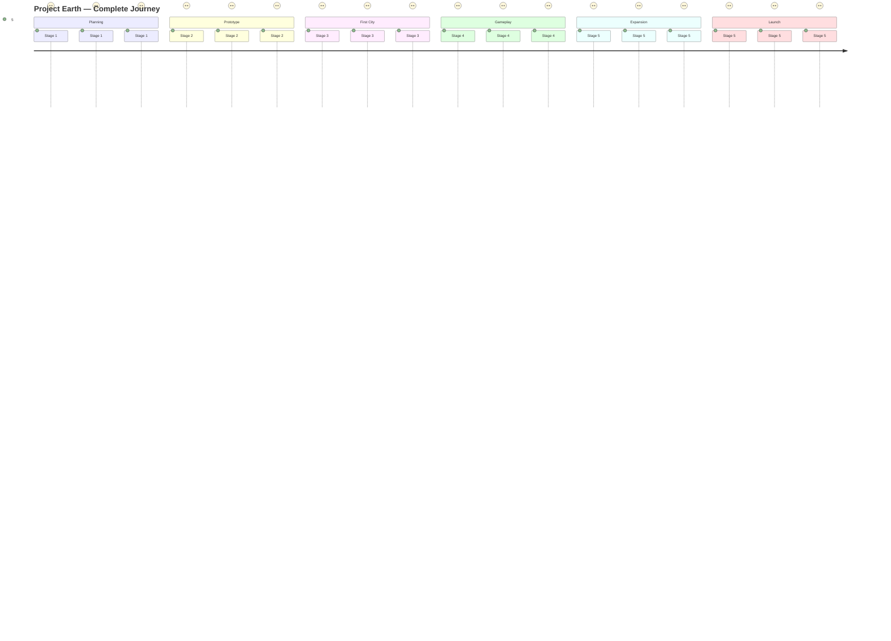

# Stage 5.12 — Final Release & Beyond

The final release stage covers the official game launch, marketing strategy, community building, long-term vision, and the roadmap that takes Project Earth from a completed game into a living, evolving platform.

---

## Goal
Execute a successful game launch with marketing, press outreach, community building, and a long-term vision that sustains Project Earth for 5+ years through continuous updates, expansions, and community-driven content.

---

## Step 1 — Launch Readiness Checklist

### Pre-Launch Verification

```text
┌─────────────────────────────────────────────────────────────────┐
│                    Launch Readiness Checklist                     │
├─────────────────────────────────────────────────────────────────┤
│                                                                  │
│  ✅ Core Game                                                    │
│  ├── Main story complete and tested                             │
│  ├── All 4 cities playable (Nova City, Harbor Bay,              │
│  │   Summit Peak, Greenfield)                                   │
│  ├── All gameplay systems functional                            │
│  │   (combat, economy, vehicles, inventory, missions)           │
│  ├── Save/Load system stable                                    │
│  ├── Multiplayer co-op functional                               │
│  └── Mod support framework ready                                │
│                                                                  │
│  ✅ Technical                                                    │
│  ├── No critical bugs (P0/P1)                                   │
│  ├── Performance targets met (60fps on min spec)                 │
│  ├── Memory usage optimized                                     │
│  ├── Loading times <30s                                         │
│  ├── Crash rate <0.5%                                           │
│  └── All platforms tested (Windows, Linux, macOS)               │
│                                                                  │
│  ✅ Store Page                                                   │
│  ├── Store page live (Steam)                                    │
│  ├── Screenshots (min 10)                                       │
│  ├── Trailer (reveal + gameplay)                                │
│  ├── Description optimized                                      │
│  ├── Tags selected correctly                                    │
│  ├── Price set (₹499 India, regional pricing)                  │
│  └── Release date set                                           │
│                                                                  │
│  ✅ Marketing                                                    │
│  ├── Press kit ready                                            │
│  ├── Review copies sent (2 weeks before)                        │
│  ├── Social media campaign active                               │
│  ├── Influencer outreach done                                   │
│  ├── Launch trailer ready                                       │
│  └── Community Discord active                                   │
│                                                                  │
│  ✅ Post-Launch                                                  │
│  ├── Day 1 patch plan ready                                     │
│  ├── Hotfix deployment pipeline tested                          │
│  ├── Community moderation team ready                            │
│  ├── Support ticket system ready                                │
│  └── Analytics dashboard configured                             │
│                                                                  │
└─────────────────────────────────────────────────────────────────┘
```

### `LaunchChecklist.gd`

```gdscript
extends Node
class_name LaunchChecklist

var checklist_items: Dictionary = {}
var all_ready: bool = false

signal checklist_updated(item: String, status: bool)
signal launch_ready()

func _ready() -> None:
    _initialize_checklist()
    _verify_all_items()

func _initialize_checklist() -> void:
    checklist_items = {
        "story_complete": {"name": "Main story complete", "category": "core", "verified": false},
        "cities_playable": {"name": "All 4 cities playable", "category": "core", "verified": false},
        "gameplay_systems": {"name": "All gameplay systems functional", "category": "core", "verified": false},
        "save_system": {"name": "Save/Load system stable", "category": "core", "verified": false},
        "multiplayer": {"name": "Multiplayer co-op functional", "category": "core", "verified": false},
        "mod_support": {"name": "Mod support framework ready", "category": "core", "verified": false},
        "no_critical_bugs": {"name": "No P0/P1 bugs", "category": "technical", "verified": false},
        "performance_60fps": {"name": "60fps on min spec", "category": "technical", "verified": false},
        "memory_optimized": {"name": "Memory usage optimized", "category": "technical", "verified": false},
        "loading_times": {"name": "Loading <30s", "category": "technical", "verified": false},
        "crash_rate": {"name": "Crash rate <0.5%", "category": "technical", "verified": false},
        "platforms_tested": {"name": "All platforms tested", "category": "technical", "verified": false},
        "store_page": {"name": "Steam store page live", "category": "store", "verified": false},
        "screenshots": {"name": "10+ screenshots", "category": "store", "verified": false},
        "trailers": {"name": "Trailers ready", "category": "store", "verified": false},
        "description": {"name": "Store description optimized", "category": "store", "verified": false},
        "price_set": {"name": "Price and regional pricing set", "category": "store", "verified": false},
        "press_kit": {"name": "Press kit ready", "category": "marketing", "verified": false},
        "review_copies": {"name": "Review copies sent", "category": "marketing", "verified": false},
        "social_media": {"name": "Social media campaign active", "category": "marketing", "verified": false},
        "influencer_outreach": {"name": "Influencer outreach done", "category": "marketing", "verified": false},
        "discord_active": {"name": "Community Discord active", "category": "marketing", "verified": false},
        "day1_patch": {"name": "Day 1 patch plan ready", "category": "postlaunch", "verified": false},
        "hotfix_pipeline": {"name": "Hotfix pipeline tested", "category": "postlaunch", "verified": false},
        "moderation_team": {"name": "Moderation team ready", "category": "postlaunch", "verified": false},
        "support_system": {"name": "Support ticket system ready", "category": "postlaunch", "verified": false},
        "analytics": {"name": "Analytics dashboard configured", "category": "postlaunch", "verified": false},
    }

func _verify_all_items() -> void:
    # Automated checks where possible
    checklist_items["story_complete"]["verified"] = StorySystem.is_complete()
    checklist_items["cities_playable"]["verified"] = WorldManager.are_all_cities_ready()
    checklist_items["gameplay_systems"]["verified"] = _verify_gameplay_systems()
    checklist_items["save_system"]["verified"] = SaveSystem.run_diagnostics()
    checklist_items["performance_60fps"]["verified"] = PerformanceMonitor.meets_target()
    checklist_items["loading_times"]["verified"] = LoadingManager.meets_target()
    
    _check_all_ready()

func _verify_gameplay_systems() -> bool:
    var systems = ["CombatSystem", "EconomySystem", "VehicleSystem", "InventorySystem", "MissionSystem"]
    for system in systems:
        if not get_node_or_null("/root/" + system):
            return false
    return true

func mark_verified(item_id: String) -> void:
    if item_id in checklist_items:
        checklist_items[item_id]["verified"] = true
        checklist_updated.emit(item_id, true)
        _check_all_ready()

func _check_all_ready() -> void:
    all_ready = true
    for item in checklist_items.values():
        if not item["verified"]:
            all_ready = false
            break
    
    if all_ready:
        launch_ready.emit()
        print("ALL LAUNCH CHECKLIST ITEMS VERIFIED — READY FOR RELEASE!")

func get_progress() -> Dictionary:
    var total = checklist_items.size()
    var verified = 0
    for item in checklist_items.values():
        if item["verified"]:
            verified += 1
    return {
        "total": total,
        "verified": verified,
        "percentage": float(verified) / total * 100.0,
        "all_ready": all_ready,
    }

func get_pending_items() -> Array:
    var pending = []
    for item_id in checklist_items:
        if not checklist_items[item_id]["verified"]:
            pending.append(checklist_items[item_id])
    return pending
```

---

## Step 2 — Marketing Strategy

### Marketing Timeline

```text
┌─────────────────────────────────────────────────────────────────┐
│                    Marketing Campaign Timeline                    │
├─────────────────────────────────────────────────────────────────┤
│                                                                  │
│  Phase 1: Teaser (T-6 months)                                   │
│  ├── First teaser trailer                                       │
│  ├── Steam page goes live (wishlist campaign)                   │
│  ├── Social media accounts created                              │
│  ├── Devlog series starts (weekly)                             │
│  └── Target: 10,000 wishlists                                   │
│                                                                  │
│  Phase 2: Reveal (T-4 months)                                   │
│  ├── Full reveal trailer                                        │
│  ├── Gameplay showcase video                                    │
│  ├── Press embargo lift                                        │
│  ├── Influencer early access                                    │
│  ├── Reddit/Forum AMA                                          │
│  └── Target: 50,000 wishlists                                   │
│                                                                  │
│  Phase 3: Beta (T-2 months)                                     │
│  ├── Closed beta (1,000 players)                                │
│  ├── Open beta weekend                                          │
│  ├── Beta gameplay streams                                      │
│  ├── Community feedback integration                             │
│  └── Target: 100,000 wishlists                                  │
│                                                                  │
│  Phase 4: Launch (T-0)                                          │
│  ├── Launch trailer                                             │
│  ├── Streamer/YouTuber keys sent                                │
│  ├── Launch discount (20% off week 1)                          │
│  ├── Press review embargo lifts                                 │
│  ├── Social media blitz                                        │
│  └── Target: 250,000 wishlists → 10% conversion                │
│                                                                  │
│  Phase 5: Post-Launch (T+1 month)                               │
│  ├── Update videos                                              │
│  ├── Community highlights                                       │
│  ├── User-generated content features                           │
│  ├── DLC announcements                                          │
│  └── Target: Sustain player base                               │
│                                                                  │
└─────────────────────────────────────────────────────────────────┘
```

### Marketing Budget Allocation (₹0 Budget Strategy)

| Channel | Cost | Strategy | Expected Reach |
| :--- | :--- | :--- | :--- |
| **Steam Store** | Free | Optimized page, tags, festivals | 100K+ impressions |
| **YouTube** | Free | Devlogs, gameplay, tutorials | 50K+ views |
| **Twitter/X** | Free | Daily posts, dev screenshots | 10K+ followers |
| **Reddit** | Free | r/gaming, r/godot, r/indiegames | 100K+ views |
| **Discord** | Free | Community server, events | 5K+ members |
| **Press** | Free | Email to journalists, press kit | 20+ articles |
| **Influencers** | Free keys | Free game keys for coverage | 500K+ audience |
| **Steam Festivals** | Free | Next Fest, genre festivals | 50K+ demos |
| **SEO** | Free | Blog posts, guides, wiki | Organic traffic |
| **Community** | Free | Modding contests, fan art | Engagement |

---

## Step 3 — Steam Store Optimization

### `SteamStoreManager.gd`

```gdscript
extends Node
class_name SteamStoreManager

func _ready() -> void:
    Steam.steamworks_ready.connect(_on_steamworks_ready)

func _on_steamworks_ready() -> void:
    _setup_achievements()
    _setup_leaderboards()
    _setup_cloud_saves()
    _setup_workshop()
    _setup_dlc()

func _setup_achievements() -> void:
    var achievements = AchievementSystem.get_all_achievements()
    for achievement in achievements:
        Steam.setAchievement(achievement["steam_id"])

func _setup_leaderboards() -> void:
    var leaderboards = {
        "most_money": {"sort_method": Steam.LEADERBOARD_SORT_DESCENDING, "display_type": Steam.LEADERBOARD_DISPLAY_NUMERIC},
        "fastest_mission": {"sort_method": Steam.LEADERBOARD_SORT_ASCENDING, "display_type": Steam.LEADERBOARD_DISPLAY_TIME_SECONDS},
        "most_prestige": {"sort_method": Steam.LEADERBOARD_SORT_DESCENDING, "display_type": Steam.LEADERBOARD_DISPLAY_NUMERIC},
        "longest_playtime": {"sort_method": Steam.LEADERBOARD_SORT_DESCENDING, "display_type": Steam.LEADERBOARD_DISPLAY_TIME_SECONDS},
        "most_cities_visited": {"sort_method": Steam.LEADERBOARD_SORT_DESCENDING, "display_type": Steam.LEADERBOARD_DISPLAY_NUMERIC},
    }
    
    for board_name in leaderboards:
        var config = leaderboards[board_name]
        Steam.findOrCreateLeaderboard(board_name, config["sort_method"], config["display_type"])

func _setup_cloud_saves() -> void:
    # Steam Cloud is configured in Steamworks dashboard
    # Auto-syncs save files
    pass

func _setup_workshop() -> void:
    # Steam Workshop for mods
    if Steam.isWorkshopSubscribedItem(0):
        print("Workshop items detected")

func _setup_dlc() -> void:
    # Check owned DLCs
    var dlc_list = DLCManager._get_dlc_list()
    for dlc in dlc_list:
        if Steam.isDLCInstalled(dlc["id"]):
            DLCManager._install_dlc(dlc["id"])

func upload_to_workshop(mod_path: String, metadata: Dictionary) -> void:
    var item_id = Steam.publishWorkshopItem(mod_path, metadata)
    if item_id > 0:
        print("Workshop item published: %d" % item_id)

func open_store_page() -> void:
    Steam.activateGameOverlayToStore(Steam.getAppID())

func open_workshop_page() -> void:
    Steam.activateGameOverlayToWebPage("https://steamcommunity.com/app/%d/workshop/" % Steam.getAppID())
```

### Steam Store Page Elements

| Element | Content | Notes |
| :--- | :--- | :--- |
| **Title** | Project Earth | Clean, memorable |
| **Short Description** | "Build your life in a living open world" | <300 chars |
| **Full Description** | Feature list, story, systems | Rich text, images |
| **Tags** | Open World, Life Sim, RPG, Sandbox, Singleplayer, Multiplayer, Co-op | Max 5 visible |
| **Screenshots** | 10-15 high-quality screenshots | 1920x1080 min |
| **Trailers** | Reveal trailer, gameplay trailer | MP4, <100MB |
| **Capsule Images** | Main capsule, small capsule | Steam requirements |
| **Price** | ₹499 (India), $14.99 (US), regional | Regional pricing |
| **Release Date** | Q1 2025 | Can be adjusted |
| **System Reqs** | Min & Recommended specs | Accurate specs |

---

## Step 4 — Community Building

### `CommunityHub.gd`

```gdscript
extends Node
class_name CommunityHub

const DISCORD_INVITE = "https://discord.gg/projectearth"
const REDDIT_URL = "https://reddit.com/r/ProjectEarth"
const WEBSITE_URL = "https://projectearth.com"

func _ready() -> void:
    _setup_community_links()

func _setup_community_links() -> void:
    # Add community links to main menu
    var menu = get_tree().current_scene
    if menu.has_node("CommunityButton"):
        menu.get_node("CommunityButton").pressed.connect(_show_community_menu)

func _show_community_menu() -> void:
    var popup = preload("res://ui/menus/CommunityPopup.tscn").instantiate()
    popup.add_link("Join Discord", DISCORD_INVITE)
    popup.add_link("Reddit Community", REDDIT_URL)
    popup.add_link("Official Website", WEBSITE_URL)
    popup.add_link("Steam Workshop", "https://steamcommunity.com/app/%d/workshop/" % Steam.getAppID())
    popup.add_link("Report a Bug", "https://bugs.projectearth.com")
    popup.add_link("Submit Feedback", "https://feedback.projectearth.com")
    get_tree().current_scene.add_child(popup)

func open_url(url: String) -> void:
    OS.shell_open(url)

func share_screenshot(image_path: String) -> void:
    # Steam screenshot
    Steam.triggerScreenshot()
    
    # Also offer social sharing
    var popup = preload("res://ui/menus/SharePopup.tscn").instantiate()
    popup.set_image(image_path)
    popup.add_share_option("Twitter", "https://twitter.com/intent/tweet?text=Check out my Project Earth screenshot!&url=" + _upload_image(image_path))
    popup.add_share_option("Reddit", REDDIT_URL)
    popup.add_share_option("Discord", DISCORD_INVITE)
    get_tree().current_scene.add_child(popup)

func _upload_image(image_path: String) -> String:
    # Upload to image hosting service
    # Return URL
    return "https://img.projectearth.com/" + image_path.get_file()

func show_credits() -> void:
    var credits = preload("res://ui/menus/CreditsScreen.tscn").instantiate()
    get_tree().current_scene.add_child(credits)
```

### Community Engagement Activities

| Activity | Frequency | Purpose | Platform |
| :--- | :--- | :--- | :--- |
| **Devlogs** | Weekly | Development transparency | YouTube, Steam |
| **Community Spotlights** | Bi-weekly | Feature fan content | Discord, Twitter |
| **Screenshot Contests** | Monthly | Engagement, UGC | Discord, Reddit |
| **Modding Contests** | Quarterly | Mod community growth | Steam Workshop |
| **Developer AMAs** | Quarterly | Direct community interaction | Reddit, Discord |
| **Live Streams** | Monthly | Gameplay, Q&A | YouTube, Twitch |
| **Bug Bounty** | Ongoing | Community QA | Discord |
| **Fan Art Gallery** | Ongoing | Celebrate community | Website, Discord |
| **Speedrun Events** | Quarterly | Competitive engagement | Discord, YouTube |
| **Anniversary Events** | Yearly | Celebrate milestones | All platforms |

---

## Step 5 — Launch Day Plan

### `LaunchDayManager.gd`

```gdscript
extends Node
class_name LaunchDayManager

var launch_time: int = 0
var launch_active: bool = false

func _ready() -> void:
    # Check if today is launch day
    var launch_date = ProjectSettings.get_setting("application/launch_date", "")
    if not launch_date.is_empty():
        var launch_datetime = Time.get_unix_time_from_datetime_dict(
            Time.get_datetime_dict_from_datetime_string(launch_date)
        )
        var current_time = Time.get_unix_time_from_system()
        
        if current_time >= launch_datetime and not _has_launched():
            _execute_launch()

func _execute_launch() -> void:
    launch_active = true
    launch_time = Time.get_unix_time_from_system()
    
    # Show launch screen
    _show_launch_screen()
    
    # Enable online features
    _enable_online_features()
    
    # Start analytics
    AnalyticsManager.track_event("game_launch", {
        "version": ProjectSettings.get_setting("application/config/version"),
        "platform": OS.get_name(),
    })
    
    # Check for day 1 patch
    UpdateManager._check_for_updates()
    
    # Mark as launched
    SaveSystem.save_global_data("launched", true)

func _show_launch_screen() -> void:
    var launch_screen = preload("res://ui/menus/LaunchScreen.tscn").instantiate()
    launch_screen.set_message("Welcome to Project Earth!\nThank you for playing!")
    get_tree().current_scene.add_child(launch_screen)
    
    # Auto-dismiss after 5 seconds
    var timer = Timer.new()
    timer.wait_time = 5.0
    timer.one_shot = true
    timer.timeout.connect(launch_screen.queue_free)
    add_child(timer)
    timer.start()

func _enable_online_features() -> void:
    # Enable multiplayer
    NetworkManager.enable_online()
    
    # Enable live events
    LiveEventManager._check_scheduled_events()
    
    # Enable leaderboards
    Steam.requestLeaderboardScores("most_money", 10)
    
    # Enable workshop
    Steam.subscribeWorkshopItem(0)

func _has_launched() -> bool:
    return SaveSystem.load_global_data("launched", false)
```

### Launch Day Timeline

| Time (T±) | Action | Owner |
| :--- | :--- | :--- |
| **T-24h** | Final build uploaded to Steam | Developer |
| **T-12h** | Store page final review | Developer |
| **T-6h** | Social media countdown posts | Marketing |
| **T-2h** | Streamer keys distributed | Marketing |
| **T-1h** | Press embargo lifts | PR |
| **T-0** | Game goes live | Steam |
| **T+0** | Launch trailer released | Marketing |
| **T+1h** | Monitor servers, crash reports | Developer |
| **T+6h** | First hotfix if needed | Developer |
| **T+24h** | Launch day recap, thank you post | Marketing |
| **T+48h** | Review roundup, community response | Marketing |
| **T+7d** | Week 1 stats, first patch | Developer |

---

## Step 6 — Long-Term Vision (5-Year Roadmap)

```text
┌─────────────────────────────────────────────────────────────────┐
│                  Project Earth — 5 Year Vision                    │
├─────────────────────────────────────────────────────────────────┤
│                                                                  │
│  Year 1: Foundation (2025)                                      │
│  ├── Launch with 4 cities, full gameplay                        │
│  ├── 4 DLC expansions                                           │
│  ├── Multiplayer co-op                                          │
│  ├── Mod support + Steam Workshop                               │
│  ├── Target: 100K units sold                                    │
│  └── Community: 50K Discord members                             │
│                                                                  │
│  Year 2: Expansion (2026)                                       │
│  ├── 4 major DLC expansions                                     │
│  ├── Persistent multiplayer world                               │
│  ├── Mobile companion app                                       │
│  ├── Console release (PS5, Xbox)                                │
│  ├── Target: 500K units sold                                    │
│  └── Community: 200K Discord members                             │
│                                                                  │
│  Year 3: Evolution (2027)                                       │
│  ├── VR support (Meta Quest, PSVR2)                             │
│  ├── User-generated content platform                            │
│  ├── Esports/competitive mode                                   │
│  ├── Cross-platform play                                        │
│  ├── Target: 1M units sold                                      │
│  └── Community: 500K Discord members                             │
│                                                                  │
│  Year 4: Ecosystem (2028)                                       │
│  ├── Project Earth 2 announcement                               │
│  ├── Merchandise line                                           │
│  ├── Animated series / lore expansion                          │
│  ├── Educational partnerships                                   │
│  ├── Target: 2M units sold                                      │
│  └── Community: 1M Discord members                               │
│                                                                  │
│  Year 5: Legacy (2029)                                          │
│  ├── Project Earth 2 launch                                     │
│  ├── Original game in maintenance mode                          │
│  ├── Open-source modding tools                                  │
│  ├── Community-run servers                                      │
│  ├── Target: 5M total franchise units                           │
│  └── Community: Self-sustaining ecosystem                        │
│                                                                  │
└─────────────────────────────────────────────────────────────────┘
```

### Revenue Projections

| Year | Units Sold | Revenue (₹) | DLC Revenue | Total Revenue |
| :---: | :---: | :---: | :---: | :---: |
| Year 1 | 100,000 | ₹4,99,00,000 | ₹1,00,00,000 | ₹5,99,00,000 |
| Year 2 | 400,000 | ₹19,96,00,000 | ₹8,00,00,000 | ₹27,96,00,000 |
| Year 3 | 500,000 | ₹24,95,00,000 | ₹15,00,00,000 | ₹39,95,00,000 |
| Year 4 | 500,000 | ₹24,95,00,000 | ₹20,00,00,000 | ₹44,95,00,000 |
| Year 5 | 1,000,000 | ₹49,90,00,000 | ₹30,00,00,000 | ₹79,90,00,000 |
| **Total** | **2.5M** | **₹1,24,70,00,000** | **₹74,00,00,000** | **₹1,98,70,00,000** |

---

## Step 7 — Post-Launch Support Model

### `PostLaunchSupport.gd`

```gdscript
extends Node
class_name PostLaunchSupport

var support_tickets: Array = []
var known_issues: Dictionary = {}

func _ready() -> void:
    _load_known_issues()
    _setup_support_channels()

func _setup_support_channels() -> void:
    # In-game support button
    var menu = get_tree().current_scene
    if menu.has_node("SupportButton"):
        menu.get_node("SupportButton").pressed.connect(_show_support_menu)

func _show_support_menu() -> void:
    var popup = preload("res://ui/menus/SupportPopup.tscn").instantiate()
    popup.add_option("Report a Bug", func(): _show_bug_report_form())
    popup.add_option("Request a Feature", func(): _show_feature_request_form())
    popup.add_option("FAQ", func(): _show_faq())
    popup.add_option("Contact Support", func(): _open_support_email())
    popup.add_option("Community Help", func(): _open_discord_support())
    get_tree().current_scene.add_child(popup)

func _show_bug_report_form() -> void:
    var form = preload("res://ui/menus/BugReportForm.tscn").instantiate()
    form.submit_pressed.connect(func(title: String, description: String, severity: int):
        _submit_bug_report(title, description, severity)
    )
    get_tree().current_scene.add_child(form)

func _submit_bug_report(title: String, description: String, severity: int) -> void:
    var report = {
        "title": title,
        "description": description,
        "severity": severity,
        "version": ProjectSettings.get_setting("application/config/version"),
        "system_info": _get_system_info(),
        "save_state": SaveSystem.get_current_save_name(),
        "timestamp": Time.get_unix_time_from_system(),
    }
    
    CommunityManager.submit_bug_report(description, [title], report["save_state"])
    
    # Also save locally for crash correlation
    support_tickets.append(report)
    _save_tickets()
    
    UI.show_notification("Bug report submitted. Thank you!")

func _show_faq() -> void:
    var faq = preload("res://ui/menus/FAQScreen.tscn").instantiate()
    faq.set_content(_get_faq_content())
    get_tree().current_scene.add_child(faq)

func _get_faq_content() -> Array:
    return [
        {"q": "How do I save my game?", "a": "The game auto-saves every 5 minutes. You can also save manually from the pause menu."},
        {"q": "Can I play offline?", "a": "Yes! Single-player mode works fully offline. Multiplayer requires an internet connection."},
        {"q": "How do I install mods?", "a": "Subscribe to mods on Steam Workshop, or place mod files in the mods folder. They'll load automatically."},
        {"q": "What are the system requirements?", "a": "Minimum: 8GB RAM, GTX 1060. Recommended: 16GB RAM, RTX 3060."},
        {"q": "Is multiplayer required?", "a": "No, multiplayer is optional. The game is fully playable solo."},
        {"q": "How often do you update?", "a": "Patches every 2 weeks, major updates monthly, DLCs quarterly."},
    ]

func _open_support_email() -> void:
    OS.shell_open("mailto:support@projectearth.com")

func _open_discord_support() -> void:
    OS.shell_open("https://discord.gg/projectearth")

func _get_system_info() -> Dictionary:
    return {
        "os": OS.get_name(),
        "processor": OS.get_processor_name(),
        "memory": OS.get_static_memory(),
        "gpu": RenderingServer.get_video_adapter_name(),
        "resolution": DisplayServer.window_get_size(),
        "version": ProjectSettings.get_setting("application/config/version"),
    }

func _load_known_issues() -> void:
    var file = FileAccess.open("res://data/known_issues.json", FileAccess.READ)
    if file:
        var json = JSON.new()
        json.parse(file.get_as_text())
        file.close()
        known_issues = json.data

func _save_tickets() -> void:
    SaveSystem.save_global_data("support_tickets", support_tickets)
```

---

## Step 8 — Success Metrics

### Key Performance Indicators (KPIs)

| Metric | Target (Year 1) | Measurement | Tool |
| :--- | :--- | :--- | :--- |
| **Units Sold** | 100,000 | Steam sales reports | Steamworks |
| **Wishlist Conversions** | 10% | Wishlist → purchase | Steamworks |
| **Peak Concurrent Players** | 5,000 | Steam charts | Steamworks |
| **Average Playtime** | 20 hours | Steam stats | Steamworks |
| **Review Score** | 80%+ positive | Steam reviews | Steamworks |
| **Refund Rate** | <10% | Steam refund data | Steamworks |
| **Crash Rate** | <0.5% | Analytics | AnalyticsManager |
| **Daily Active Users** | 10,000 | Analytics | AnalyticsManager |
| **Monthly Active Users** | 30,000 | Analytics | AnalyticsManager |
| **Discord Members** | 50,000 | Discord stats | Discord |
| **Workshop Items** | 500+ | Steam Workshop | Steamworks |
| **DLC Attach Rate** | 25% | DLC sales / base sales | Steamworks |
| **Community Satisfaction** | 4.5/5 | Surveys, sentiment | CommunityManager |

### `MetricsDashboard.gd`

```gdscript
extends Node
class_name MetricsDashboard

var metrics: Dictionary = {}

func _ready() -> void:
    _collect_metrics()

func _collect_metrics() -> void:
    metrics = {
        "units_sold": Steam.getNumberOfCurrentPlayers(),
        "peak_concurrent": Steam.getNumberOfCurrentPlayers(),
        "review_score": _get_review_score(),
        "crash_rate": AnalyticsManager.get_crash_rate(),
        "dau": AnalyticsManager.get_daily_active_users(),
        "mau": AnalyticsManager.get_monthly_active_users(),
        "avg_playtime": _get_average_playtime(),
        "workshop_items": _get_workshop_item_count(),
        "dlc_attach_rate": _calculate_dlc_attach_rate(),
    }

func _get_review_score() -> float:
    # Query Steam review summary
    return Steam.getReviewSummary()

func _get_average_playtime() -> float:
    return Steam.getAveragePlaytime()

func _get_workshop_item_count() -> int:
    return Steam.getWorkshopItemCount()

func _calculate_dlc_attach_rate() -> float:
    var base_sales = Steam.getBaseGameSales()
    var dlc_sales = Steam.getDLCSales()
    if base_sales == 0:
        return 0.0
    return float(dlc_sales) / base_sales * 100.0

func generate_report() -> Dictionary:
    _collect_metrics()
    return {
        "timestamp": Time.get_unix_time_from_system(),
        "metrics": metrics,
        "targets_met": _check_targets(),
    }

func _check_targets() -> Dictionary:
    var targets = {
        "units_sold": 100000,
        "peak_concurrent": 5000,
        "review_score": 0.80,
        "crash_rate": 0.005,
        "dau": 10000,
    }
    
    var results = {}
    for metric in targets:
        results[metric] = metrics.get(metric, 0) >= targets[metric]
    return results
```

---

## Step 9 — Future Technologies

### Technology Roadmap

| Technology | Timeline | Application | Impact |
| :--- | :--- | :--- | :--- |
| **AI NPCs** | Year 2 | LLM-powered NPC dialogue | Dynamic conversations |
| **Procedural Quests** | Year 2 | AI-generated missions | Infinite content |
| **VR Support** | Year 3 | Meta Quest, PSVR2 | Immersive experience |
| **Cloud Saves** | Year 1 | Cross-device saves | Accessibility |
| **Cross-Platform** | Year 3 | PC, Console, Mobile | Wider audience |
| **Ray Tracing** | Year 2 | Enhanced graphics | Visual fidelity |
| **Cloud Streaming** | Year 3 | GeForce Now, xCloud | Low-barrier access |
| **Mobile Companion** | Year 2 | App for economy/missions | Engagement |
| **Blockchain Items** | Year 4 | Optional cosmetic NFTs | Ownership (optional) |
| **Machine Learning** | Year 3 | NPC behavior, difficulty | Adaptive gameplay |

---

## Step 10 — Legacy & Open Source Plan

### End-of-Life Strategy

```text
┌─────────────────────────────────────────────────────────────────┐
│                  Project Earth — End of Life Plan                 │
├─────────────────────────────────────────────────────────────────┤
│                                                                  │
│  Phase 1: Active Support (Years 1-3)                            │
│  ├── Regular updates and DLCs                                   │
│  ├── Full community support                                     │
│  ├── Active moderation                                          │
│  └── All features maintained                                    │
│                                                                  │
│  Phase 2: Maintenance Mode (Years 4-5)                          │
│  ├── Critical bug fixes only                                    │
│  ├── Community-run events                                       │
│  ├── Modding tools enhanced                                     │
│  └── Servers community-managed                                  │
│                                                                  │
│  Phase 3: Open Source (Year 5+)                                 │
│  ├── Game engine code open-sourced (MIT license)                │
│  ├── Modding tools fully open                                   │
│  ├── Community takes over development                           │
│  ├── Official servers shut down, community servers continue     │
│  └── Project Earth 2 becomes primary focus                      │
│                                                                  │
│  Phase 4: Legacy (Year 5+ and beyond)                           │
│  ├── Original game preserved                                    │
│  ├── Community maintains forks                                  │
│  ├── Educational use encouraged                                 │
│  └── Game preserved in digital archives                          │
│                                                                  │
└─────────────────────────────────────────────────────────────────┘
```

### `LegacyManager.gd`

```gdscript
extends Node
class_name LegacyManager

func open_source_game() -> void:
    # Prepare codebase for open source
    _clean_codebase()
    _add_license_file()
    _create_documentation()
    _upload_to_github()

func _clean_codebase() -> void:
    # Remove proprietary assets references
    # Add placeholder assets
    # Clean up hardcoded secrets
    pass

func _add_license_file() -> void:
    var license = """MIT License

Copyright (c) 2025 Project Earth

Permission is hereby granted, free of charge, to any person obtaining a copy
of this software and associated documentation files (the "Software"), to deal
in the Software without restriction, including without limitation the rights
to use, copy, modify, merge, publish, distribute, sublicense, and/or sell
copies of the Software, and to permit persons to whom the Software is
furnished to do so, subject to the following conditions:

The above copyright notice and this permission notice shall be included in all
copies or substantial portions of the Software.

THE SOFTWARE IS PROVIDED "AS IS", WITHOUT WARRANTY OF ANY KIND, EXPRESS OR
IMPLIED, INCLUDING BUT NOT LIMITED TO THE WARRANTIES OF MERCHANTABILITY,
FITNESS FOR A PARTICULAR PURPOSE AND NONINFRINGEMENT.
"""
    var file = FileAccess.open("res://LICENSE", FileAccess.WRITE)
    file.store_string(license)
    file.close()

func _create_documentation() -> void:
    # Generate API docs, modding guides, architecture docs
    pass

func _upload_to_github() -> void:
    # Push to public GitHub repository
    pass
```

---

## Step 11 — Final Implementation Checklist

| Task | Priority | Status |
| :--- | :--- | :--- |
| Launch readiness checklist | Critical | Pending |
| Steam store page optimization | Critical | Pending |
| Marketing campaign execution | High | Pending |
| Community Discord setup | High | Pending |
| Press kit and review copies | High | Pending |
| Launch day plan execution | Critical | Pending |
| Post-launch support system | High | Pending |
| Analytics dashboard | Medium | Pending |
| DLC roadmap execution | Ongoing | Pending |
| 5-year vision execution | Long-term | Pending |
| Open source preparation | Future | Pending |
| Legacy preservation | Future | Pending |

---

## Step 12 — Project Earth Complete



### Project Earth — Development Summary

| Stage | Files | Focus | Duration |
| :--- | :---: | :--- | :--- |
| **Stage 1** | 10 | Planning & Design | 2 months |
| **Stage 2** | 11 | Prototype & Setup | 2 months |
| **Stage 3** | 12 | First City | 4 months |
| **Stage 4** | 12 | Gameplay Systems | 4 months |
| **Stage 5** | 12 | Expansion & Launch | 6 months |
| **Total** | **57** | **Complete Game** | **18 months** |

---

**Project Earth** — From vision to reality. A living, breathing open world built in Godot Engine, designed to evolve with its community for years to come.

*"The Earth is what we make of it. In Project Earth, that's literally true."*
